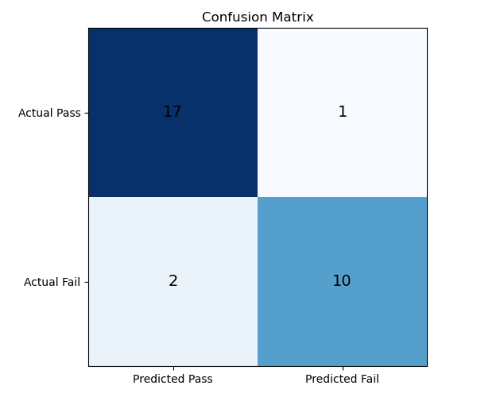
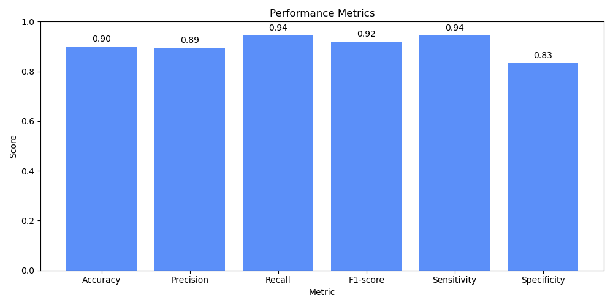

# 学生成绩分类系统

使用手写 **K 近邻（KNN）** 算法，根据学习时长、出勤率、作业完成率和历史成绩，预测课堂模拟样本的 `Pass / Fail`。提供 Tkinter 图形界面、可独立运行的控制台演示，以及混淆矩阵和指标图表。

**技术栈：Python、Tkinter、Matplotlib。** 距离计算、邻居排序、多数投票和评价指标均自行实现，没有使用 scikit-learn。此项目是算法与数据处理展示项目，尚未提供 Java 后端或 Web API。

## 功能与实现

- CSV 列名检查、无效标签过滤与缺失数值填补。
- 先划分训练集和测试集，均值填补与 min-max 归一化仅使用训练集统计，避免测试集参与预处理。
- 欧氏距离与 K=5 多数投票；票数相同时按最近邻中的首次出现顺序确定类别。
- Accuracy、Precision、Recall、F1、Sensitivity、Specificity 与混淆矩阵。
- 输入有限数值校验、模型状态校验、可复现的数据划分与自动测试。
- 数据与图表路径以代码文件所在目录为基准，可从其他工作目录启动。

## 快速运行

建议 Python 3.10 或更新版本；本次实际验证环境为 Python 3.13.9、Matplotlib 3.10.6。

在解压后的项目目录打开 PowerShell：

```powershell
python -m venv .venv
.venv\Scripts\python.exe -m pip install -r requirements.txt
.venv\Scripts\python.exe run_console_demo.py
```

控制台会打印数据规模、评估指标和三组输入的预测，并将图表写入 `outputs/`。

打开图形界面：

```powershell
.venv\Scripts\python.exe main.py
```

Tkinter 通常随 Windows 官方 Python 安装器提供；其他环境可能需要单独安装 Tk 支持。无显示器环境可用控制台入口，并设置 `MPLBACKEND=Agg`。

运行测试无需安装 Matplotlib：

```powershell
python -m unittest discover -s tests -v
```

## 数据与评估

原项目说明将 `dataset/student_performance.csv` 标为课堂模拟数据；未提供真实学校来源或公开数据集链接。CSV 有 120 条样本，不含姓名、联系方式，`StudentID` 是 1–120 的序号，不参与模型输入。发布沿用该演示文件，不声称其具有真实学生数据代表性。

| 字段 | 含义 |
|---|---|
| StudyTime | 每周学习时长 |
| AttendanceRate | 出勤百分比 |
| AssignmentCompletion | 作业完成百分比 |
| PreviousGrade | 历史成绩，0–100 |
| FinalResult | Pass / Fail 分类标签 |

使用 `seed=42`、测试比例 25%、K=5，得到以下单次留出评估：

| 指标 | 结果 |
|---|---:|
| 训练 / 测试样本 | 90 / 30 |
| Accuracy | 0.9000 |
| Precision | 0.8947 |
| Recall / Sensitivity | 0.9444 |
| F1-score | 0.9189 |
| Specificity | 0.8333 |
| TP / FP / FN / TN | 17 / 2 / 1 / 10 |





上述结果只说明模型在这份模拟数据及固定划分上的表现，不能推断真实学生的学习结果。尚未实现分层划分、交叉验证、K 值自动选择或真实外部数据验证。

## 结构

```text
data_processing.py       数据清洗、划分及训练集统计
model.py                 手写 KNN
metrics.py               混淆矩阵及指标
visualization.py         图表生成
run_console_demo.py      控制台演示
main.py                  Tkinter 图形界面
dataset/                 课堂模拟 CSV
tests/                   算法、输入与数据泄漏回归测试
docs/                    验证记录与展示图表
```

## 设计边界

min-max 超出训练范围的测试值可能小于 0 或大于 1，系统保留该外推值；训练列为常量时映射为 0。训练某列没有有效数值会明确报错。单条预测须提供四个有限数值；图形界面进一步约束非负学习时长及 0–100 的百分比和成绩。

KNN 的训练阶段存储样本，单条预测遍历距离并排序。若训练量为 n、特征数为 d，预测时间复杂度为 O(nd + n log n)，适合本项目的小数据场景。

后续可以增加真实数据集来源、交叉验证和服务端预测接口；这些是改进方向，未计入已完成功能。发布修复及测试记录见 [验证说明](docs/VALIDATION.md)。
